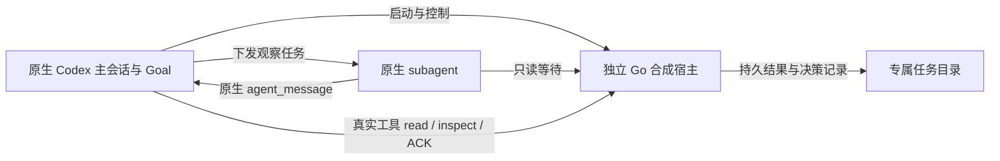

# 原生返回路线实验结果

日期：2026-09-11。macOS，原生 `codex-cli 0.153.4`；Windows 延期。主 Agent 编排、整合和验收，subagent 在独立 worktree 实现、实测与复核。

**合成任务的独立执行、原会话恢复和 ACK 已取得真实原生证据；完整 G0 仍不通过，G1–G4 未启动。** 普通子 Agent 完成不能唤醒已经结束轮次的 idle 主控；改用原生 Goal 后，恢复链路成立，但又实测到用户编辑 Goal 后旧工具单元错误完成新 Goal。已核查的受支持接口没有补齐所需的版本保护和当前 TUI 附着约束。

本轮实验、代码修复、独立复核和现场清理已完成。这里的完成指本轮实验交付，不能替代完整产品目标或 G0 放行。

## 实际形成的实现

官方 Claude 插件启发的是“宿主原生任务通道 + 自管执行运行时”。本项目沿这个方向实现了有界 Go 合成宿主，并在普通原生 Codex CLI 中验证以下组合：

关闭 TUI 后，Host 继续有限执行。普通 `codex resume <原 thread ID>` 恢复 active Goal，再发起新的真实工具读取；不会恢复旧 child 的工具 future。原生 Goal 的续跑控制项是 `role=user` 的内部 context，Host 结果另由 `custom_tool_call_output` 返回。两者没有混为同一种消息。

交付的 [Go 工具](../../../../tools/g0-return-lab/README.md) 只有固定合成执行、读取／等待及 [单事件 ACK 夹具](../../../../tools/g0-return-lab/ACK.md)。它没有实现生产调度、数据库、真实第三方 CLI adapter、多事件或部分 ACK。

## 原生实测与判定

| 场景 | 已观察结果 | 证据与边界 |
|---|---|---|
| 普通 child 完成，root 已 final→idle | 120 秒内没有自动新轮；下一次诊断用户输入后才处理旧消息 | [idle/busy 对照](runner-results.md)。不能把 UI 的 Completed 当作 root 已消费 |
| 普通 busy 与 `clock.sleep` | native agent_message 可达；一个 sleep 被消息提前打断 | 各为窄样本，是活动 turn，不替代真正 idle |
| 无 Goal，退出后普通 resume | 没有自动续轮／补交 | [对照与 Goal 路线](runner-goal-results.md) |
| active Goal，正常退出再 resume | goal-01/02/04 三个不同 root 成立；旧 TUI 消失后 Host 仍活且 result absent，随后完成；恢复无附加 prompt、真实读取、complete／ACK 后停止 | 同上。goal-03 因退出晚于结果完成排除，不凑入三次 |
| active Goal，强杀再 resume | 一个样本成立；真实 native exit 为 1，Host 继续，恢复后自动消费 | 同上。不是每个关闭屏障 20 次 |
| 用户输入与等待 | 一个真实 USER-STEER 在同一 turn 被处理，随后读取结果，无重复 start | 同上。不替代全部取消／版本竞争 |
| Host 尚运行就提前 resume | 一次 pending read、一次 Host wait，得到完成结果后 complete／ACK | 同上。没有反复模型读取 pending |
| 在线 active Goal，主控先 final | 23ms 后自动续轮，当时结果仍 pending，再通过阻塞工具等待完成 | 同上。续轮早于结果，不是结果事件触发 C05 |
| 同一 root 的第二 TUI | idle 写入者持有时第二次 resume 被 active-writer 锁拒绝；旧 TUI 退出后可接管 | [身份实验](identity-results.md)。未覆盖所有 owner 冲突屏障 |
| fork／new／clear 与 child | 新 root 不继承旧 Goal；可建立自己的 Goal；child 的 thread ID 独立，session ID 与 root 共享 | 同上。paused Goal 恢复有原生选择框；不算 active Goal 的自动恢复 |
| 用户编辑 Goal，旧 cell 仍在等待 | 新目标要求编辑后重新等 60 秒，旧 cell 在编辑确认后约 22 秒就将它标为 complete | [真实反例](identity-race-results.md)。错误转换在固定窗口第 70.160 秒；整轮结束超窗未算通过 |
| 同 root 的 owned start／ACK | 真实原生环境身份与 owner 一致，固定事件与磁盘 ACK 对齐，decision_count／effect_count 均为 1 | [正向集成](identity-ack-positive-results.md)。跨 thread 原生负向 ACK 未派发 |
| 修复后 Host-ready 与重复 ACK | Host-ready 在原 120 秒内成立；完整 ACK 超窗未通过。后续有界收尾内，主动丢弃首条 stdout 后以新 command ID 重试，仍返回首条记录，effect_count 为 1 | [goal09 原生与持久证据](runner-goal-results.md)。首个 mkdir 因预建目录失败，后面的 start 未执行；后来只有一次成功启动。不把主动丢 stdout 等同 ACK 进程崩溃 |

## 为什么不能放行

1. **Goal 不提供业务版本条件。** 原生 `update_goal` 更新当前 thread 的 Goal，没有预期 revision；Go 能拒绝旧业务 ACK，却不能原子保护或撤销原生 Goal completion。第一份竞争样本中模型主动取消了旧 cell，这种模型选择不能代替第二份样本所缺的底层保护。
2. **Goal 续轮没有当前 UI 附着条件。** 源码不检查 displayed thread／订阅；`/new`、`/clear` 不暂停旧 Goal。稳定 busy 状态下命令被禁用，但冷恢复、resume 及状态切换的交接窗口没有建立可靠正证据。没有把这个源码缺口夸大为已复现串台。
3. **主动 Goal 续轮与真正 idle 回调是不同的行为。** 在线正例不能替代原 C05；单事件本地 ACK 也不能替代原服务交付的三态对账、分页／compact、部分 ACK 和六组故障屏障。

对较新稳定版 0.154.0 已做精确源码对比：Goal 与 code-mode 的 9 个相关生产文件与 0.153.4 相同，公开更新字段仍无 revision，相关编辑链没有新增取消旧 cell 的保护。新版二进制没有运行，未升级全局安装；这个结论来自对应源码，而非把旧版样本冒充新版实测。[固定版本、字段和候选排除依据](alternatives.md)

普通队列／history 注入没有形成合法 pending-tool 回调证明；显式远程服务、改启动入口或修改原生实现会改变现有合同，也没有因此自动解决 UI 附着与 Goal 竞争。官方 Claude 插件的 SessionEnd 会终止相应任务并清理记录，其生命周期不能直接照搬。[插件实现核查](../../../../tasks/cc-plugin-review/docs/findings.md)

因此，没有为凑次数重复尚缺核心前提的 20 次屏障，未把未测试的 compact、Hook 异常／审批等待、当前 UI 切换、完整交付对账或 Windows 标为通过。跨 thread 原生负向 ACK 分支曾被平台内容检查中断；现场恢复后只完成自身任务的正向闭环，该负向项保留未验证。

## 工具验证与继续条件

Go 完整 test／race（含真实 CLI 子进程）、vet、构建和独立复核通过；主工作区整合后完整 race 为 `16.353s`、exit 0，vet exit 0。20 个并发 ACK 只提交一个合成 action 记录；更换 command ID、响应落盘后丢失、旧 revision／取消等由真实本地子进程测试覆盖。这些计数不是第三方业务派发恰好一次的证明。[Host 验证](host-ack-validation.md)、[整合验证及原设计文件 hash](main-host-verification.json)

readiness 脚本曾有宽松 Goal 匹配及未校验时间字段导出两项问题。修复已删除 Goal／rollout／SQLite 读取，仅返回 Host-ready，明确 `goal_checked=false`；8 项 CLI 回归在旧版 7 项失败、新版全部通过，独立复跑一致。新增固定 ACK 白名单 4 项回归也通过；整合后 12 项 Python 测试通过。原 Goal 资格仍由另一套类型化原生证据确认。[修复检查](runner-ready-fix-checks.json)、[最终 ACK 检查](runner-goal-09-checks.json)

四个临时 worktree、已完成的构建缓存和 416 份已摘要的 schema 均已删除。保留源提交、过滤证据、必要 job／result／ACK、原有工具链与两个审核过的二进制。运行者的 TUI／Host 均已结束。实验脚本刻意绑定本次 UUID 与路径；重放需重建对应专用环境，不能当成通用安装入口。[清理及二进制清单](cleanup.json)

下一次推进需要可检查的原生能力变化：能区分 Goal 替换及同一 Goal 编辑的版本条件更新，或编辑目标时使旧工具动作失效的原子语义；可靠且可失效的当前 TUI→thread 附着信号；以及满足原工具结果／交付对账合同的恢复通道。具体字段、固定版本源码、原生 turn／工具记录和故障样本，才是足以重新启动对应实验的“新的原生接口证据”。
